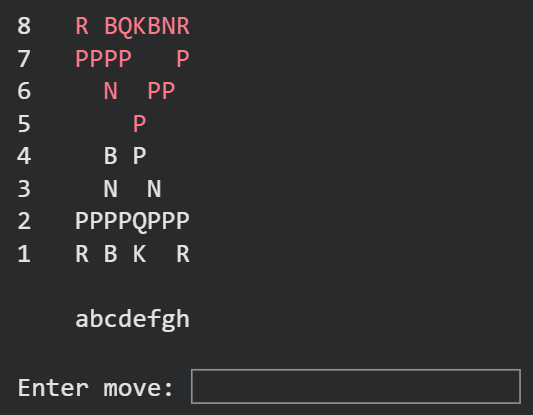
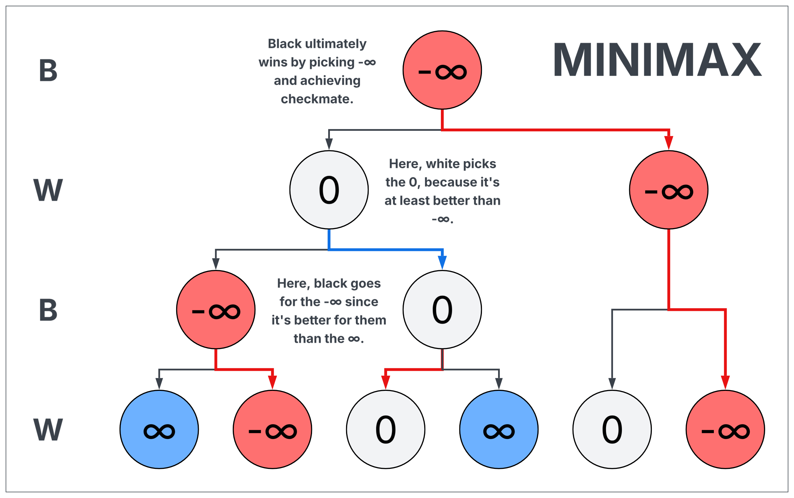

# Fishstock

Have you ever wanted to play chess in your Python console? I think that may not be as unreasonable an assumption as others I've made, but if you *really* wanted to, you wouldn't use this version. There are better ones. But despite that, I like this little project. Because, come on, who hasn't wanted to know how a chess bot worked?

## What is this, like, actually?

*Fishstock* is a Python-based chess bot built entirely from scratch and implemented using the Minimax algorithm. It was made as a fun way to explore search algorithms and try to implement something relatively complicated. That part is very clear, since my implementation is... unorthodox. Either way, it works.

    

Sort of.

It's called "Fishstock" as a parody of the *actual* best chess engine in the world, which is called "Stockfish". So, this is meant to convey that my bot isn't... amazing. The main bottleneck is computing power. I can't run more than 3 depth layers on this without it taking an eternity. Maybe my implementation, full of dictionaries and stuff, doesn't help. And I did make the heuristic "by hand".

Either way, it doesn't matter. The project does what it was meant to do: play chess.
*(It doesn't understand castling, though. I forgot to implement that.)*

## How do I play against it?

Run the script. Yeah, that's really it. Then, to play, you must input your moves in a very specific way. When it's your turn, write your move in the form `s1 s2`, where `s1` is the square where the piece you want to move is located, and `s2` is the square you want to move it to. For example, if I were to start the game off as white by moving the e2 pawn to e4, I'd type `e2 e4`. That's it.

*(Yes, I do know this is not the usual way to input chess moves, and I don't care. It removes possible ambiguity. This is better.)*

## How does it work?

Minimax is actually quite a simple algorithm, and chess is not required to understand it. But let's use chess anyway.

Suppose you're shown a position, and you determine that white has been checkmated. Now, the previous move was black's turn, and, if they were playing logically, their best move would have been to make the specific decision that leads to a checkmate-in-one. If we go back one move further, it's white's turn, and they'd likely avoid that move that gives black the opportunity to checkmate them (unless it's forced).

Minimax is like doing this, but going *very* far into the decision tree, and in a much more deliberate way. Imagine going down the entire chess decision tree until every game ends in checkmate or a draw. Assign every terminal position (one where the game ends) a number: $\infty$ if white won, $-\infty$ if black won, and zero if it's a tie. If we assign these numbers, it's clear someone playing as white would want to avoid low numbers ($-\infty$ is the lowest there is) and chase high numbers, and black would aim for the opposite.

Now, move up one layer in the decision tree. You are now at a position that is exactly one move away from ending the game. Now, let's assume it's white's turn. If white is presented with two possible moves: one that leads to a $-\infty$ and one that leads to a $\infty$, they'll obviously take the $\infty$ to immediately win. If the options had been zero or $-\infty$, they'd have taken the zero to secure a draw. So, a logical player as white would always pick higher numbers. Thus, that position's value is ultimately the highest value among its options, because that's what the player will choose. The reverse goes for black.

Finally, imagine repeating this process many, many times, going up the entire tree until you reach the game's current position. Once you reach this state, you already know which path leads to the best possible outcome for the current player. Thus, you have essentially solved the game.

    

Yes, this algorithm isn't just good at chess. Technically, it's the best possible player. You cannot make a better algorithm in terms of its "skill".

The only issue is that this would be absurdly slow. Using this algorithm correctly requires going all the way down the decision tree for chess, which is computationally impossible, as there's simply way too many moves. It can't be done in a billion, let alone a trillion years.

So, after a few layers of search, we have to cut the algorithm off. But if the game hasn't ended yet, how do we decide the number for those positions?

Well, that's where our own human judgment comes in. It's our job to design some sort of function to evaluate a position and give it a value from $-\infty$ to $\infty$, determining how good it would be for black or white. A $-2$, for instance, would represent a position that is generally unfavorable for white, but not necessarily losing. The only issue is that these functions can't ever be perfect, but they can be improved and iterated upon greatly to reach very successful bots.

There are also other optimizations, like alpha-beta pruning. This is a little system where we track the highest possible number white can guarantee at any position, and also the lowest number black can guarantee. If, at any point, white's value is greater than black's value, that decision is sub-optimal because:

- **If white is playing,** they know black won't allow them to even reach that branch, so they shouldn't even try.
- **If black is playing,** they know white won't let them take such a low value and can guarantee a higher one, so that path isn't worth considering.

In other words, this allows us to prematurely cut branches of the decision tree without having to fully traverse them, saving tons of time and computing power.

---

Anyway, that's it. Thanks a lot for checking out this project: it really was fun to make when I made it. Now, it's a nice little toy. Cool!
